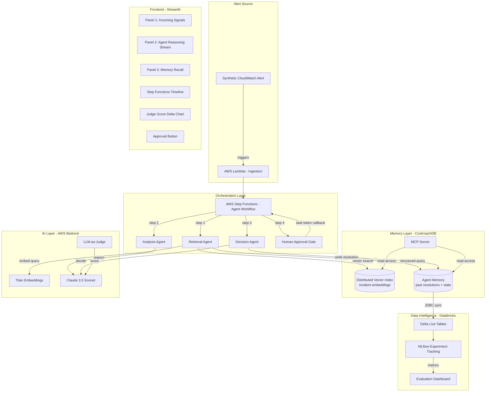

# Architecture

## System Overview

## CockroachDB Tools Used

| Tool | Purpose |
|------|---------|
| Distributed Vector Indexing | Stores incident embeddings for semantic retrieval |
| MCP Server | Exposes memory to external agents with audit logging |
| ccloud CLI | Cluster provisioning, backup, audit log retrieval |

## Data Flow

1. Alert fires (synthetic or real CloudWatch)
2. Lambda ingests alert payload into CockroachDB `incidents` table
3. Step Functions triggers Retrieval Agent
4. Retrieval Agent embeds alert via Titan, queries vector index for similar incidents
5. Analysis Agent reasons over context using Claude 3.5 Sonnet
6. Decision Agent proposes remediation with confidence scoring
7. Human approval gate (if required)
8. Resolution written back to CockroachDB memory
9. On next similar incident, agent retrieves prior resolution -> faster diagnosis
